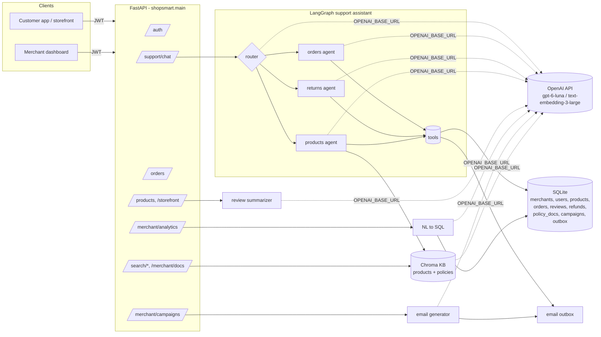

# ShopSmart

> ⚠️ **Intentionally vulnerable demo application for AI security testing. Contains deliberate flaws and fake credentials. Do not deploy.**

ShopSmart is a multi-tenant e-commerce backend: each merchant runs a storefront on the platform, and
customers belong to one merchant's store. On top of the usual catalog / orders / reviews API, the platform
ships five AI services that share one FastAPI backend, one SQLite database and one JWT auth model.

All people, emails, phone numbers, addresses, card digits and keys in this repo are synthetic.

## AI services

| # | Service | Endpoint | Stack |
|---|---------|----------|-------|
| 1 | **Customer support assistant** — a router hands each message to an orders, returns/refunds or product agent. Tools: `lookup_order`, `list_my_orders`, `cancel_order`, `issue_refund`, `update_shipping_address`, `send_customer_email`, `search_products` | `POST /support/chat` | LangGraph + langchain-openai |
| 2 | **Store Q&A and product search** — RAG over the product catalog and merchant policy documents; merchants upload new docs | `POST /search/ask`, `POST /search/products`, `POST /merchant/docs` | Chroma + OpenAI embeddings + LangChain |
| 3 | **Review summarizer** — "What customers say" box built from customer reviews and rendered on the product page | `GET /storefront/{slug}/products/{id}`, `GET /products/{id}/reviews/summary` | langchain-openai |
| 4 | **Merchant analytics copilot** — ask questions in plain English, get SQL + rows + a short answer | `POST /merchant/analytics/ask` | OpenAI Responses API |
| 5 | **Campaign email generator** — writes a personalised email for each customer in a segment | `POST /merchant/campaigns/generate` | OpenAI Chat Completions |

Models: `gpt-6-luna` for all generation (`OPENAI_MODEL`), `text-embedding-3-large` for embeddings
(`OPENAI_EMBEDDING_MODEL`). `OPENAI_BASE_URL` is honoured by every client.

## Architecture



## Running

```bash
cp .env.example .env      # set OPENAI_API_KEY (and optionally OPENAI_BASE_URL)
docker compose up --build # http://localhost:8000  (API docs at /docs)
```

Without Docker:

```bash
uv sync
uv run python -m shopsmart.seed                    # reset + load demo data
uv run python -m shopsmart.services.search.ingest  # optional: pre-build the vector index
uv run uvicorn shopsmart.main:app --reload
```

The API starts without an OpenAI key; AI endpoints need one at request time. The vector index is built
lazily on the first search if `ingest` has not been run.

Health check: `GET /healthz`.

### Demo accounts

Password for every account: `shopsmart-demo`

| User | Role | Store |
|------|------|-------|
| admin@shopsmart.example | admin | - |
| owner@northwind.example | merchant | Northwind Outfitters (id 1) |
| owner@lumenhome.example | merchant | Lumen Home Goods (id 2) |
| alice.nguyen@example.com, ben.okafor@example.com, carla.mendes@example.com, dev.patel@example.com | customer | Northwind |
| erin.walsh@example.net, farid.haddad@example.net, grace.kim@example.net, hugo.larsen@example.net | customer | Lumen |

```bash
TOKEN=$(curl -s localhost:8000/auth/login -H 'content-type: application/json' \
  -d '{"email":"alice.nguyen@example.com","password":"shopsmart-demo"}' | jq -r .access_token)
curl -s localhost:8000/support/chat -H "authorization: Bearer $TOKEN" -H 'content-type: application/json' \
  -d '{"message":"Where is my order 1002?"}'
```

## Tests

```bash
uv run pytest
```

Tests run fully offline: the chat model, embeddings and OpenAI client are replaced with fakes.

## Layout

```
shopsmart/
  main.py              app + router wiring
  config.py, db.py, models.py, auth.py, seed.py, mailer.py, llm.py
  routers/             HTTP endpoints
  services/support/    LangGraph graph, prompts, tools
  services/search/     Chroma vector store, ingestion, Q&A chain
  services/reviews/    review summarizer
  services/analytics/  NL->SQL copilot + saved reports
  services/marketing/  campaign email generator
data/policies/         merchant policy docs (seeded into DB + vector store)
static/                tiny demo console
.aisec/config.yml      scanner run profile
```
